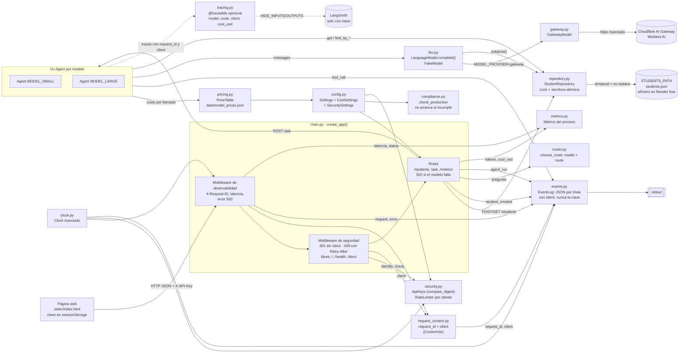
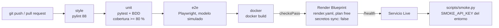

# Arquitectura del Classroom Assistant

El producto es un registro de alumnos (nombre, materia, grado y salón) con un asistente que responde preguntas
sobre ellos. Es una API FastAPI sin estado de negocio: los datos viven en un archivo JSON que solo toca el
repositorio. Cada fase le agrega algo:

- **Fase 2, observabilidad**: un id por petición, log JSON, métricas del proceso y trazas opcionales.
- **Fase 3, costos**: el modelo real (Workers AI por AI Gateway) y cuatro palancas de costo para `POST /ask`.
- **Fase 4, producción**: una clave por cliente, límite de peticiones y compliance al arrancar. Se empaqueta en
  un contenedor, pasa por un CI de cuatro etapas y se publica en Render.

## Publicación

## Piezas

- `config.py`: lee y valida las variables de las cuatro fases y llama al compliance. No guarda
  `LANGSMITH_API_KEY`, y no muestra `CF_API_TOKEN` ni `API_KEYS` en `repr`.
- `compliance.py`: con `ENVIRONMENT=production` no deja arrancar con el modelo simulado, sin claves o con claves
  cortas, ni con trazas que no ocultan entradas y salidas.
- `security.py`: interpreta `API_KEYS`, identifica al cliente con `hmac.compare_digest` y lleva el límite por
  cliente con ventana deslizante.
- `pricing.py`: precios por millón de tokens y el costo de una llamada.
- `router.py`: elige `MODEL_SMALL` o `MODEL_LARGE` y dice el motivo.
- `gateway.py`: llama a AI Gateway. Toda falla se vuelve `ModelUnavailable`.
- `clock.py`: hora UTC y reloj monotónico inyectables. Lo usan la latencia, el log y el límite.
- `request_context.py`: el `request_id` y el cliente autenticado, cada uno en su `ContextVar`.
- `events.py`: eventos con campos fijos y `client`. No llevan datos personales ni claves.
- `metrics.py`: contadores, p50/p95, SLO y costo acumulado del proceso.
- `tracing.py`: trazas de LangSmith, privadas por omisión, con modelo, ruta, cliente y costo.
- `repository.py`: el único acceso al archivo. Da ids `STU-NNNN` consecutivos bajo candado.
- `llm.py`: la interfaz de modelo, el modelo simulado determinista y `build_model`.
- `agent.py`: protocolo JSON, tope de vueltas, ventana de historial y costo por llamada.
- `main.py`: los dos middlewares (observabilidad por fuera, seguridad por dentro), Pydantic estricto, las rutas
  y un agente por modelo.
- `static/index.html`: tiene el campo de clave (contraseña, en `sessionStorage`), el alta, la lista y el chat.
  Muestra «Clave inválida» y «Demasiadas peticiones». Escribe solo con `textContent`.
- `Dockerfile`, `.github/workflows/ci.yml`, `render.yaml` y `scripts/smoke.py`: empaquetan, prueban, publican y
  comprueban.

## Decisiones

- [0001 API sin estado con repositorio de archivo JSON atómico](adr/0001-stateless-api.md)
- [0002 Un solo agente de solo lectura con bucle con tope](adr/0002-read-only-agent-bounded-loop.md)
- [0003 Interfaz de modelo, modelo simulado e inyección](adr/0003-model-interface-and-injection.md)
- [0004 Id por petición y eventos JSON con campos fijos](adr/0004-request-id-and-json-events.md)
- [0005 Métricas en memoria del proceso, excepción acotada al ADR 0001](adr/0005-in-process-metrics.md)
- [0006 Trazas opcionales en LangSmith, privadas por omisión](adr/0006-optional-langsmith-tracing.md)
- [0007 Modelo real por AI Gateway con cliente HTTP inyectado](adr/0007-gateway-model-injected-http.md)
- [0008 Enrutamiento por regla en código, un agente por modelo](adr/0008-rule-based-routing.md)
- [0009 Costo por llamada con tabla de precios validada al arrancar](adr/0009-cost-per-call-and-price-table.md)
- [0010 Clave por cliente y límite de peticiones en un middleware](adr/0010-api-keys-and-rate-limit-middleware.md)
- [0011 Compliance como código: el producto no arranca si incumple](adr/0011-compliance-as-code-at-startup.md)
- [0012 Contenedor, CI en cuatro etapas y Render con disco efímero](adr/0012-container-ci-and-render.md)
- Lista de compliance: [compliance-checklist.md](compliance-checklist.md), que escribe `security`.
